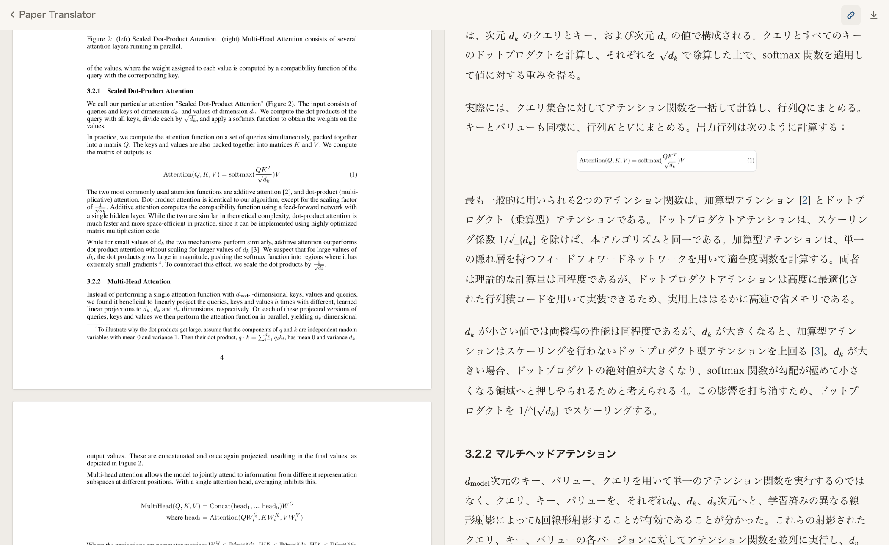
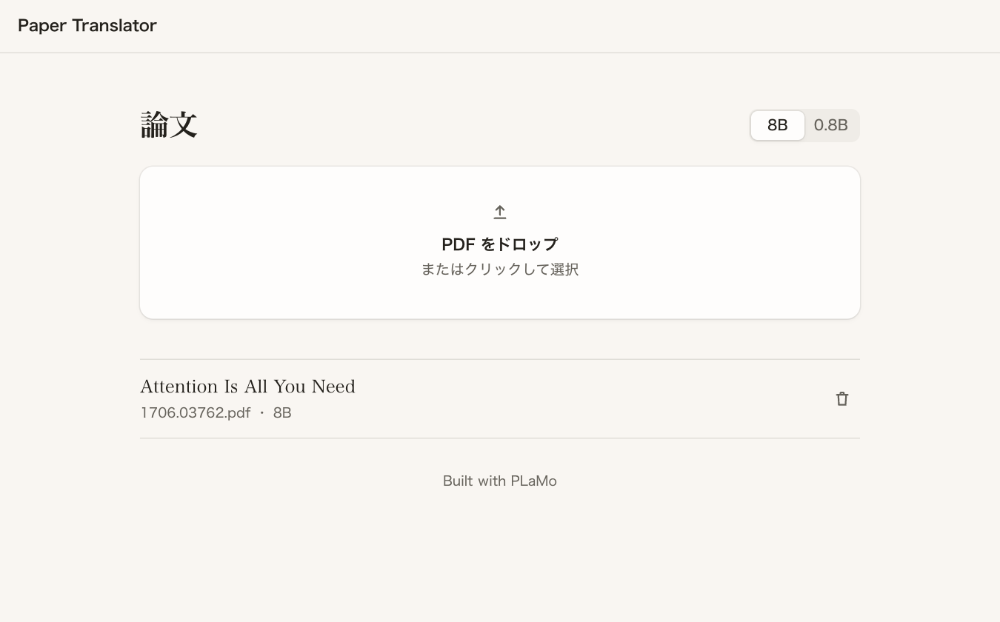
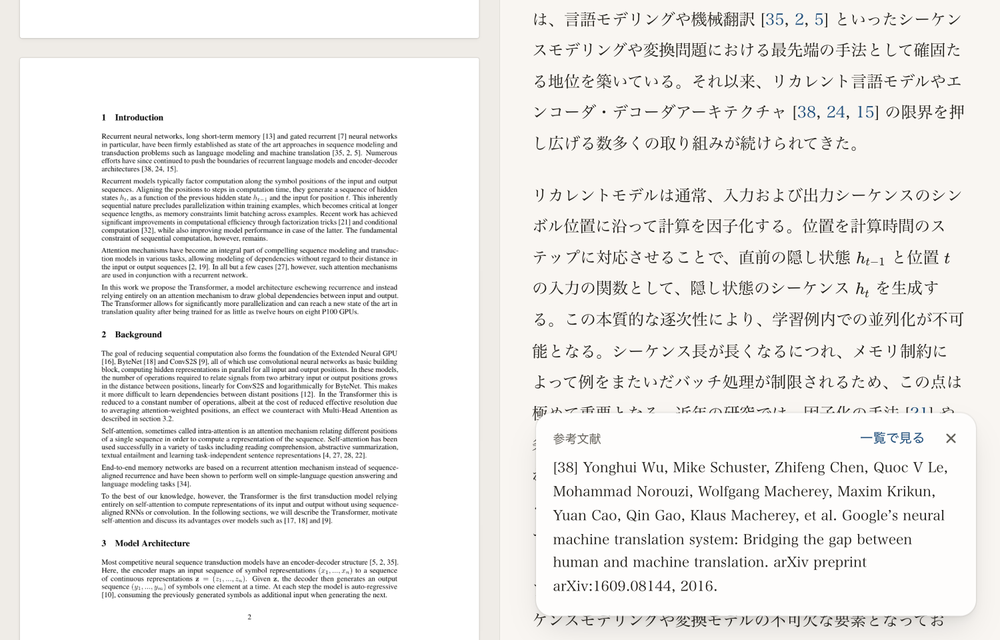
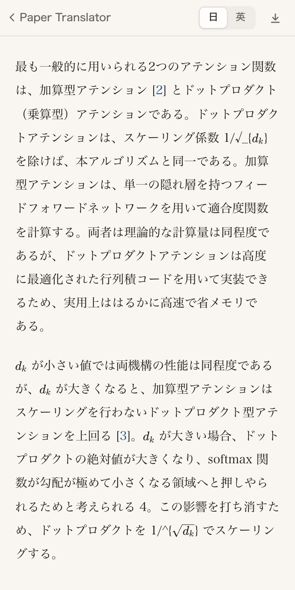
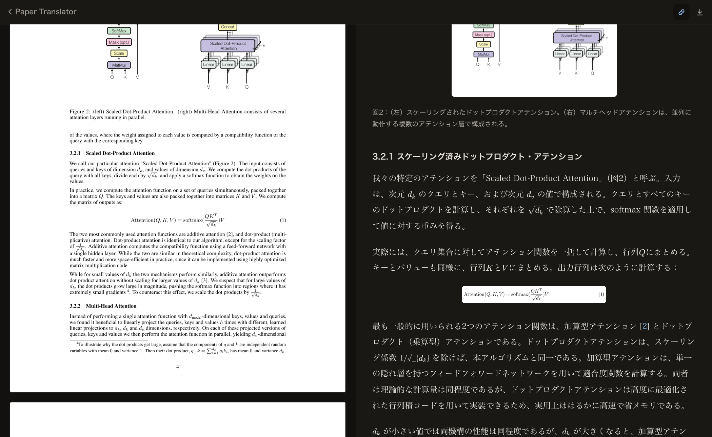
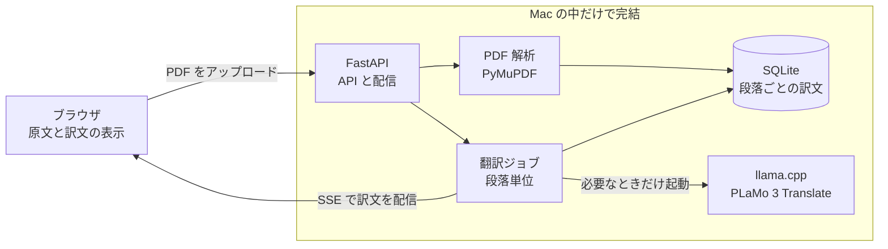

# Paper Translator

英語論文の PDF を、手元の Mac だけで和訳して読むための Web アプリです。
翻訳モデルをローカルで動かすので、論文を外部サービスへ送りません。
原文ページと訳文を並べて、図表、数式、引用を行き来しながら読めます。



## 特徴

- ネットワークを使わずに翻訳します。[PLaMo 3 Translate](https://huggingface.co/pfnet/plamo-3-translate-8b-GGUF) を llama.cpp で動かし、UI の依存ライブラリも同梱しています。
- 2 段組の読み順、ページをまたぐ段落、図表、数式、参考文献を、PDF の座標とフォント情報から復元します。
- スクロールが左右で追従し、段落をクリックすると対応箇所へ移動します。
- 文中の `1/√d_k`、`O(n^2 · d)`、`ℝ^{d_model}` や変数を KaTeX で組版し、別行の数式は PDF から切り出して表示します。
- `[6]` や `(Peters et al., 2018a)` を押すと、読む位置を変えずに文献の内容を確認できます。
- 用語集を該当する段落にだけ渡して、論文全体の訳語を揃えます。
- 段落ごとに保存するので途中から再開でき、同じ PDF は再翻訳しません。
- 8B と 0.8B のモデルを切り替えられます。モデルは翻訳中だけ読み込み、終わると自動で解放します。

| 一覧 | 引用カード | スマートフォン幅 | ダークモード |
| --- | --- | --- | --- |
|  |  |  |  |

スクリーンショットの論文は [Attention Is All You Need](https://arxiv.org/abs/1706.03762)（Vaswani et al., 2017）です。

## はじめかた

必要なものは次の 3 つです。動作は Apple Silicon の macOS（メモリ 16GB）で確認しています。

- [uv](https://docs.astral.sh/uv/getting-started/installation/)
- [llama.cpp](https://github.com/ggml-org/llama.cpp)。`llama` か `llama-server` のコマンドを自動で探します。
- 約 6GB の空き容量（モデルの保存先）

```sh
git clone https://github.com/zerozero-0-0/paper-translater.git
cd paper-translater
uv run paper-translator setup
uv run paper-translator
```

`setup` は llama.cpp を確認し、配布元からモデルを取得します。モデルの取得が終わったあとは、ネットワークなしで翻訳できます。

http://127.0.0.1:8787 を開いて PDF をドロップすると、翻訳が始まります。

## モデルの選び方

Attention Is All You Need（15 ページ、翻訳対象 103 段落）を Apple M1（メモリ 16GB）で翻訳した結果です。

| モデル | 全文の翻訳時間 | 向いている使い方 |
| --- | --- | --- |
| 8B（既定） | 約 8 分 | 論文をじっくり読むとき |
| 0.8B | 約 80 秒 | 内容を素早くつかみたいとき |

8B は 0.8B を下書きに使う投機的デコーディングで動かします。比較に使った 9 段落では、出力を変えずに生成速度が約 2 倍になりました。

## 仕組み



設計の背景と実測値は [docs/design.md](docs/design.md) にまとめています。

## 設定

| ファイル | 内容 |
| --- | --- |
| `models/models.toml` | モデルの定義、ポート、文体、モデルを解放するまでの秒数 |
| `models/glossary.toml` | 訳語集。原文に語が含まれる段落にだけ渡します |

設定は起動時に読み込むので、変更したらアプリを再起動してください。アップロードした PDF と訳文は `data/` に保存します。

## 開発

```sh
uv run pytest
node --test tests/math.test.js
uv run ruff check .
```

テストはモデルなしで動きます。翻訳サーバーの代わりに偽のサーバーを使います。

```text
src/paper_translator/
├── pdf.py       PDF から読み順どおりの段落、図表、参考文献を取り出す
├── llm.py       llama.cpp の起動と停止、翻訳リクエスト
├── worker.py    段落単位の翻訳ジョブと進捗の配信
├── store.py     SQLite への保存
├── setup.py     初回セットアップ
├── app.py       API と静的ファイルの配信
└── static/      UI（ビルド不要の HTML、CSS、JavaScript）
```

## 制限

- 対応するのはテキストを含む PDF です。スキャン PDF は OCR が必要なため未対応です。
- 添字が次の行と同じブロックに入る配置では、その文が分断されることがあります。
- 総和記号を含む文中の数式は正しく組版できないことがあります。原文ページで確認できます。
- 2 段組の論文のスクロール追従はページ単位のおおまかな動きになります。
- キャプションのない図は原文ページでのみ表示します。
- 動作確認は macOS と `llama` コマンドで行いました。ほかの OS と `llama-server` では確認していません。

## ライセンス

ソースコードは [GNU AGPL v3.0](LICENSE) で公開しています。

**Built with PLaMo**。モデルの利用には PLaMo Community License が適用されます。条件と同梱ソフトウェアは [NOTICE.md](NOTICE.md) を確認してください。
