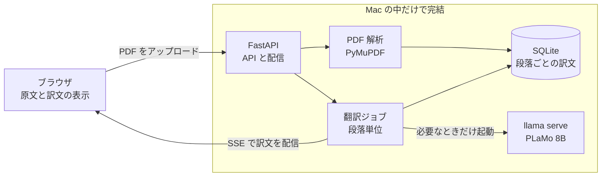

# Paper Translator

英語論文の PDF を、手元の Mac だけで和訳して読むための Web アプリです。
翻訳モデルをローカルで動かすので、論文を外部サービスへ送りません。
原文ページと訳文を並べて、図表、数式、引用を行き来しながら読めます。


## 特徴

- **ネットワークを使わない翻訳**: [PLaMo 翻訳モデル](https://huggingface.co/pfnet/plamo-3-translate-8b-GGUF) を llama.cpp で動かします。UI の依存ライブラリも同梱しています。
- **論文の構造を理解した抽出**: 2 段組の読み順、ページをまたぐ段落、図表、数式、参考文献を PDF の座標とフォント情報から復元します。
- **原文との連動**: スクロールが左右で追従し、段落をクリックすると対応箇所へ移動します。
- **読める数式**: 文中の `1/√d_k` のような式を KaTeX で組版し、別行の数式は PDF から切り出して表示します。
- **押せる引用**: `[6]` や `(Peters et al., 2018a)` を押すと、読む位置を変えずに文献の内容を確認できます。
- **訳語の統一**: 用語集を該当する段落にだけ渡して、論文全体の訳語を揃えます。
- **中断に強いジョブ**: 段落ごとに保存するので途中から再開でき、同じ PDF は再翻訳しません。
- **軽い常駐**: モデルは翻訳中だけ読み込み、終わると自動で解放します。

| 一覧 | 引用カード | スマートフォン幅 | ダークモード |
| --- | --- | --- | --- |
|  |  |  |  |

スクリーンショットの論文は [Attention Is All You Need](https://arxiv.org/abs/1706.03762)（Vaswani et al., 2017）です。

## 仕組み



設計の背景と実測値は [docs/design.md](docs/design.md) にまとめています。

## 実測

Apple M1（メモリ 16GB）、`plamo-3-translate-8b` Q4_K_M、Attention Is All You Need（15 ページ、翻訳対象 103 段落）で計測しました。

| 項目 | 結果 |
| --- | --- |
| 論文全体の翻訳時間 | 約 12.5 分 |
| 生成速度 | 約 10 トークン/秒 |
| PDF 解析 | 約 3 秒 |
| 翻訳中の Python 処理の CPU 使用率 | 1 コアの 0.26%（簡易クライアントで再現） |
| 参考文献の分割 | 2 本の論文の全 96 件が PDF 内のリンク先の数と一致 |
| 本文の引用の対応付け | 番号形式 58/58、著者年形式 93/93 |

## 使い方

Apple Silicon の macOS で動作を確認しています。[uv](https://docs.astral.sh/uv/) と [llama.cpp](https://github.com/ggml-org/llama.cpp) の `llama` コマンドが必要です。

1. [pfnet/plamo-3-translate-8b-GGUF](https://huggingface.co/pfnet/plamo-3-translate-8b-GGUF) から `plamo-3-translate-8b-Q4_K_M.gguf` を取得し、`models/` に置きます。
2. `models/models.toml` の `binary` を、`llama` コマンドのパスに合わせます。
3. 起動します。

```sh
uv run paper-translator
```

http://127.0.0.1:8787 を開いて PDF をドロップすると、翻訳が始まります。

## 設定

| ファイル | 内容 |
| --- | --- |
| `models/models.toml` | 使用モデル、ポート、文体、停止までの秒数 |
| `models/glossary.toml` | 訳語集。原文に語が含まれる段落にだけ渡します |

設定は起動時に読み込みます。アップロードした PDF と訳文は `data/` に保存します。

## 開発

```sh
uv run pytest
node --test tests/math.test.js
uv run ruff check .
```

テストはモデルなしで動きます。翻訳サーバーの代わりに偽のサーバーを使います。

```text
src/paper_translator/
├── pdf.py       PDF から読み順どおりの段落、図表、参考文献を取り出す
├── llm.py       llama serve の起動と停止、翻訳リクエスト
├── worker.py    段落単位の翻訳ジョブと進捗の配信
├── store.py     SQLite への保存
├── app.py       API と静的ファイルの配信
└── static/      UI（ビルド不要の HTML、CSS、JavaScript）
```

## 制限

- 対応するのはテキストを含む PDF です。スキャン PDF は OCR が必要なため未対応です。
- 添字が次の行と同じブロックに入る配置では、その文が分断されることがあります。
- 総和記号を含む文中の数式は、正しく組版できないことがあります。原文ページで確認できます。
- 2 段組の論文のスクロール追従は、ページ単位のおおまかな動きになります。
- キャプションのない図は、原文ページでのみ表示します。

## 使用しているソフトウェア

- [PyMuPDF](https://pymupdf.readthedocs.io/)（AGPL-3.0）
- [KaTeX](https://katex.org/)（MIT、`static/vendor/katex` に同梱）
- [FastAPI](https://fastapi.tiangolo.com/)、[llama.cpp](https://github.com/ggml-org/llama.cpp)
- PLaMo 翻訳モデルの利用条件は、配布元のモデルカードを確認してください。
